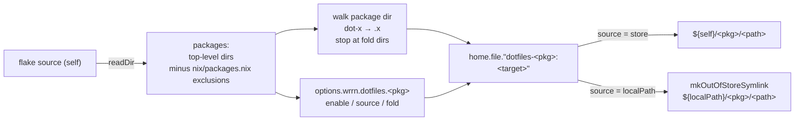

# Home Manager module for dotfiles

## Background

dotfiles is a set of GNU Stow packages: each top-level directory mirrors
`$HOME`, with `dot-foo` standing for `.foo`. The `Makefile` stows them with
`--no-folding` (one link per file), except `pi`, which is folded.

`flake.nix` exports one derivation per directory (`packages.<system>.fish`).
`~/nixos-config` uses them in about 20 modules, each with a hand-written
`home.file` entry such as `"${dotfiles.fish}/dot-config/fish"` →
`.config/fish` with `recursive = true`. Each entry hardcodes the package's
layout. `modules/pi` has a one-off variant that links to the working clone
with `mkOutOfStoreSymlink`, because pi writes to its config files.

`~/burrow/pi-agents` (`nix/home-manager.nix`) already exports a Home Manager
module with a `checkout` option that switches between the store copy and a
working clone. This design brings the same idea to dotfiles, per package.

## Problem

- Every consumer re-derives where a package's files go.
- Store links mean an edit needs a commit, push, `nix flake update dotfiles`
  and a rebuild. Only pi can link to the clone, through custom code.
- There is no single switch to turn a dotfiles package on or off.

## Goals

- A Home Manager module, `homeManagerModules.default`, with an `enable`
  option per package: `wrrn.dotfiles.<package>.enable`.
- A per-package `source`: `"store"` (the locked flake input) or
  `"localPath"` (a working clone at `wrrn.dotfiles.localPath`).
- Link targets derived from the stow layout, so consumers name only the
  package.
- Migrate `~/nixos-config` to the module.

## Non-Goals

- Replacing the `Makefile`. Stow stays as the fallback without Nix.
- Linking packages that don't mirror `$HOME` (`firefox`, `brew`,
  `bettertouchtool`). Consumers keep reading those files directly.
- Enabling packages nixos-config doesn't manage today (kitty, zsh, …).

## Questions and Answers

1. Q: What is the option path?
   A: Flat: `wrrn.dotfiles.fish.enable`. Global options sit next to the
   packages (`wrrn.dotfiles.localPath`); evaluation fails if a package is
   ever named like a global option.
2. Q: Is the store/clone choice global or per package?
   A: Per package, as an enum: `source = "store" | "localPath"`. The clone's
   location is global (`localPath`), since the whole repo lives in one place.
   `source` defaults to `"localPath"` when `localPath` is set, else `"store"`.
3. Q: Why an enum, not a boolean?
   A: It names both choices and leaves room for another mode (for example a
   copy for programs that reject symlinks) without changing the interface.
4. Q: Per-file links or whole directories?
   A: Per file by default, matching `--no-folding` and today's
   `recursive = true`. Programs write state next to their config (fish,
   emacs), and other sources share directories (ghostty `themes/`).
   `fold` opts specific directories into a single link.
5. Q: Why not HM's `recursive = true`?
   A: It doesn't expand `mkOutOfStoreSymlink` sources. The module enumerates
   files itself in both modes, so switching `source` changes where links
   point, never which paths are links.
6. Q: Where does the file list come from in `localPath` mode?
   A: The locked flake input; pure evaluation can't read the clone. Edits to
   existing files are live; a new file is linked after
   `nix flake update dotfiles` and a rebuild, unless it's under a `fold`ed
   directory.
7. Q: Keep the Makefile?
   A: Yes.
8. Q: Keep `packages` and `overlays`?
   A: Yes, for compatibility. nixos-config stops using them.

## Design



Files:

- `nix/home-manager.nix`: the module, `self: { config, lib, ... }: { … }`,
  same shape as `pi-agents/nix/home-manager.nix`.
- `nix/packages.nix`: `notPackages` (top-level dirs that aren't packages:
  `nix`, `design-log`) and `notLinkable` (packages without a `$HOME` layout).
- `flake.nix`: exports `homeManagerModules.default` and
  `homeModules.default`; `packages` skips hidden dirs and `notPackages`.

Options:

```nix
wrrn.dotfiles.localPath : null | str      # absolute path of the clone
wrrn.dotfiles.<pkg>.enable : bool         # default false
wrrn.dotfiles.<pkg>.source : enum [ "store" "localPath" ]
wrrn.dotfiles.<pkg>.fold : listOf str     # target dirs, e.g. [ ".config/emacs" ]
```

Behaviour:

- Each `home.file` entry sets `force = true`, replacing links left by stow.
- An assertion fails if a package uses `"localPath"` while `localPath` is
  null, or names a `fold` directory that doesn't exist.
- Activation warns if `localPath` is in use and the directory is missing.

## Implementation Plan

1. Write `nix/packages.nix`, `nix/home-manager.nix`, update `flake.nix`.
   Verify: `nix flake check`; evaluate the module from nixos-config with
   `--override-input dotfiles git+file://…?rev=<commit>`.
2. nixos-config: import the module through `home-manager.sharedModules` in
   `modules/home-manager`. Add `modules/dotfiles` (sets `localPath`) and
   import it on bandit and lona, the hosts that already rely on the clone for
   pi.
3. nixos-config: replace each module's `home.file` block with
   `wrrn.dotfiles.<pkg>.enable = true`. `modules/pi` sets
   `source = "localPath"` explicitly and loses its custom linking.
4. Verify: build bandit's `home-files` and diff the file list and file
   contents against the pre-migration build; evaluate lona's `home.file` and
   compare targets.

## Examples

```nix
# ✅ name the package; the layout comes from the repo
wrrn.dotfiles.fish.enable = true;

# ❌ hardcode the layout in the consumer
home.file.fish = {
  source = "${dotfiles.fish}/dot-config/fish";
  target = ".config/fish/";
  recursive = true;
};

# Live clone for everything, except niri pinned to flake.lock
wrrn.dotfiles = {
  localPath = "${config.home.homeDirectory}/burrow/dotfiles";
  fish.enable = true;
  niri = { enable = true; source = "store"; };
};
```

## Trade-offs

- Gains: one switch per package, live edits without rebuilds, no layout
  knowledge in nixos-config, and the pi special case goes away.
- Costs: with `localPath`, uncommitted and half-finished edits are live, and
  new files need a flake update to be linked. Packages now link everything
  they contain (niri also links `~/.local/bin/rcmd`).

## Implementation Results

Built as designed in `nix/home-manager.nix`, `nix/packages.nix` and
`flake.nix`. nixos-config migrated in one change; `modules/dotfiles` sets
`localPath` on bandit and lona.

Verification:

- Standalone evaluation against nixos-config's locked Home Manager and
  nixpkgs: store and `localPath` sources, a per-package `"store"` override,
  `fold` (including a trailing slash), both assertions, and paths with spaces
  (`leader-key`). A `home-files` build with a folded directory and spaces
  resolves every link.
- bandit: `home-files` before and after the migration have the same 144 paths,
  executable bits and file contents. 109 links now resolve into the clone
  (5 before, all pi). The full `darwin-system` builds.
- lona (evaluation only, no Linux builder): the old `recursive` entries,
  expanded with the repo's file list, match the new targets. The only
  addition is `~/.local/bin/rcmd` from the niri package. Non-dotfiles
  `home.file` entries are unchanged.

Deviations from the discussion before this log:

- `fold` is a list of directories, not a boolean. A boolean has no clear
  meaning without stow's "highest directory that doesn't exist yet" rule,
  which depends on the machine's state. `pi` isn't folded: folding it would
  link `~/.pi/agent` whole and collide with pi-agents, which links into that
  directory. nixos-config already linked pi per file.
- `leader-key` is linkable. Its layout mirrors `$HOME`
  (`Library/Application Support/Leader Key`), so only `firefox`, `brew` and
  `bettertouchtool` are excluded.
- nixos-config's firefox module read `dotfiles.packages.<system>.firefox`
  with `readFile`, which is import-from-derivation, so a Linux host couldn't
  be evaluated on macOS. It now reads the flake source (separate commit,
  same contents).
- nixos-config's wezterm module linked `.wezterm.lua` to
  `~/.config/wezterm/wezterm.lua`; the package links `~/.wezterm.lua`.
  No host imports that module.
- `nix-builder` doesn't evaluate before or after this change (`called
  without required argument 'niri'`), so it wasn't compared.

Follow-up: removed `fold`. Nothing used it, and no package benefits:
folding `pi` would make `~/.pi/agent` one link, putting `auth.json` and
sessions in the repo and pi-agents' links inside the clone; folding emacs
would do the same with `elpa/` and `straight/`. pi only needs its config
files writable, which per-file out-of-store links already give it. Every
package is now linked file by file. Adding `fold` back is a small change if
a real case appears.
